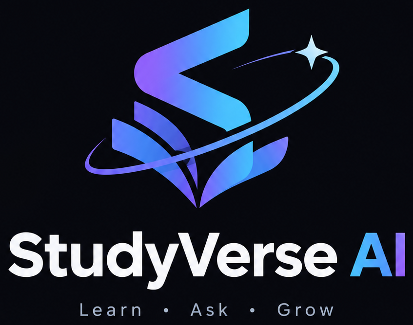
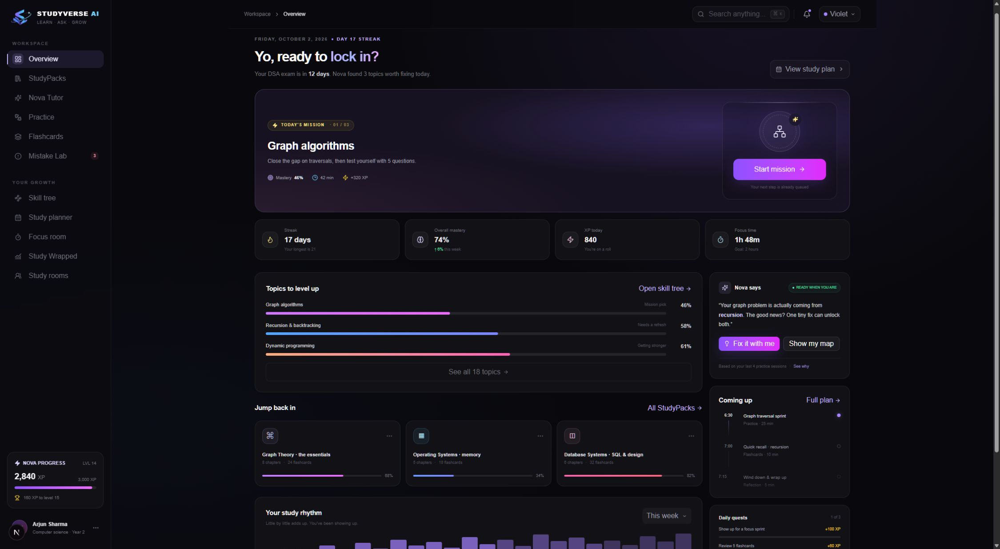

# StudyVerse AI



**Make every study session count.** StudyVerse is a dark-first, student-centered study platform that turns course material into a learning loop: import notes → build a StudyPack → learn with Nova → practice → understand mistakes → adapt the plan → focus and review.

> A polished college-demo prototype with a working browser demo mode and a FastAPI service that can be connected to PostgreSQL + pgvector, Redis, Gemini, and Google Cloud Storage.



**New here?** Watch the [first-session walkthrough](docs/tutorial-video/StudyVerse-AI-Tutorial.mp4) or read the [tutorial transcript and chapters](docs/tutorial-video/README.md).

## What’s in the demo

- A responsive dashboard with a daily mission, streak, mastery, XP, topic gaps, study packs, and Nova’s next-step recommendation.
- StudyPacks with seeded materials and a local upload flow for PDF, PPTX, DOCX, images, TXT, and Markdown.
- Nova Tutor modes (Learn, Hint, Socratic, Exam), source citations, and a conversational study loop.
- Adaptive practice across multiple choice, true/false, fill-in-the-blank, and concept-check questions, with a 1–5 confidence check and misconception signals.
- Mistake Lab, a prerequisite-linked skill map, an adjustable daily plan with `.ics` calendar export, Pomodoro focus room, weekly Study Wrapped with CSV/JSON progress export, profile, and accent themes.
- Voice notes with browser microphone recording, Markdown export, and spoken demo summaries using built-in browser text-to-speech.
- Study rooms with a seeded directory, join/create flows, and demo chat; daily streak rewards add XP and are claimable once per day in the browser.
- Sign-in/create-account screens and a three-step onboarding flow. In browser-only demo mode, local accounts use PBKDF2 password hashes stored in that browser; with `NEXT_PUBLIC_API_URL` configured, the UI uses FastAPI authentication. “Continue with demo learner” opens the app without an account.
- Seeded demo data, so the product looks alive before any API keys or student uploads exist.

The front end runs without external services. Most demo interactions are local to the browser session; streak reward claims use local storage. Calendar export creates a standard `.ics` file, but Google Calendar account sync, server-persisted voice recordings, and real-time multi-user rooms require production integrations. The API adds token-based auth and persistence hooks for production mode.

## Stack

| Layer | Technology |
|---|---|
| Web | Next.js 15, React 19, TypeScript, Tailwind CSS 4, Framer Motion, Radix UI primitives and shadcn-style components |
| API | Python 3.12, FastAPI, Pydantic, SQLAlchemy 2 async |
| Data | PostgreSQL 16 + pgvector; Redis for task broker/cache |
| AI | Google Gemini through the Google Gen AI SDK; deterministic mock tutor when demo mode is enabled |
| Files | Google Cloud Storage when configured; local ignored `uploads/` directory for development |
| Jobs | Celery worker for document chunking and indexing work |
| Delivery | Docker Compose, GitHub Actions, Vercel + Cloud Run deployment guide |

## Run locally

### Web demo, no keys required

Requires Node.js 22 and pnpm 10.

```bash
pnpm install
pnpm dev
```

Open [http://localhost:3000](http://localhost:3000). The dashboard, tutor, quiz, and focus flow use seeded mock mode.

### Full local services

Requires Docker Desktop with Compose v2.

```bash
cp .env.example .env
docker compose up --build
```

Open the web app at `http://localhost:3000` and API docs at `http://localhost:8000/docs`. Compose starts pgvector PostgreSQL, Redis, FastAPI, Celery, and Next.js. `DEMO_MODE=true` keeps the app usable without paid services.

To use PostgreSQL-backed production-mode endpoints locally, set `DEMO_MODE=false`, start the services, then apply the migration:

```bash
cd apps/api
python -m pip install -r requirements.txt
alembic upgrade head
```

Set `GEMINI_API_KEY` to enable Gemini API tutoring, or set `USE_VERTEX_AI=true` and configure the Google Cloud project and location to use Vertex AI. Configure a GCS bucket and Google Application Default Credentials to store uploads remotely. Never put credentials in source control; use a secret manager in deployed environments.

## Monorepo

```text
apps/
  web/                  Next.js app, reusable UI, onboarding and product views
  api/                  FastAPI routes, domain models, services and API tests
    app/services/       document parsing, retrieval, Gemini and storage adapters
    app/workers/        Celery app and retriable document-processing task
    migrations/         Alembic environment and PostgreSQL/pgvector schema
    tests/              API flow tests
docs/                   Architecture, API, deploy, viva, launch and resume materials
.github/workflows/      Frontend and backend CI
docker-compose.yml      Local web, API, worker, PostgreSQL and Redis
```

## Verification

```bash
pnpm --filter web typecheck
pnpm --filter web test
pnpm --filter web build
cd apps/api && python -m pip install -r requirements.txt && pytest -q
```

CI runs these same checks. See [the API guide](docs/API.md), [architecture](docs/ARCHITECTURE.md), [deployment notes](docs/DEPLOYMENT.md), and [college viva brief](docs/COLLEGE_VIVA.md).

## Screenshots

`docs/screenshots/dashboard-placeholder.svg` is a labeled placeholder. Replace it with a browser capture before sharing a public repository or LinkedIn post. See `docs/screenshots/README.md` for the recommended capture set.

## Scope and next production steps

The repository provides the product UI, demo interactions, service boundaries, schema, API routes, CI, and deployment path. Before a public launch, connect the remaining local-only browser flows to authenticated API calls, add email verification and rate limits, and run a privacy/security review. Social rooms are a basic directory/API architecture, not a live video or real-time presence system.
