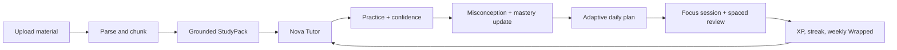
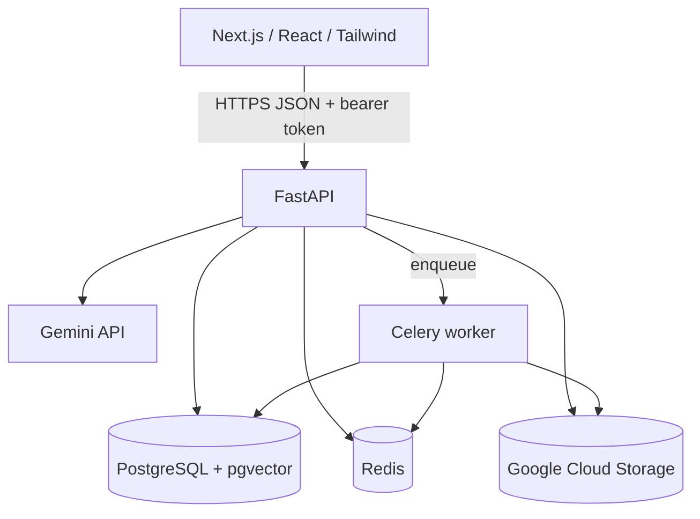

# StudyVerse AI architecture

## Product loop

## Runtime boundaries

- **Web app:** app-router shell, responsive navigation, Radix-backed design primitives with shadcn-style composition, Framer Motion transitions, and seeded client-side demo state.
- **API:** versioned endpoints under `/api/v1`; Pydantic request validation, password hashing, 12-hour JWT access tokens, allowed-origin CORS, document size/type checks, and OpenAPI docs.
- **Retrieval:** demo source chunks are ranked against query terms. In production mode with a Gemini API key or Vertex AI configured, uploads receive 768-dimensional Gemini embeddings, stored in pgvector, and tutor queries search only chunks owned by the authenticated student. A keyword path remains available when AI is not configured.
- **Files:** uploads go to GCS when a bucket/project is configured, otherwise to ignored local `uploads/`. The extraction service handles text PDFs, PPTX, DOCX, and images when optional OCR is installed. Celery can retry chunk preparation independently.
- **AI:** Gemini is called only when demo mode is off and Gemini API-key or Vertex AI authentication is configured. The prompt restricts the tutor to supplied snippets and the response returns citations with excerpts. Demo answers are deterministic and still include citations.
- **Database:** Alembic creates students, materials, knowledge chunks, and topic mastery. Demo mode intentionally bypasses the database and paid APIs so a fresh checkout starts easily.
- **Social:** room directory and create/join endpoints establish a privacy-conscious base. Real-time presence, chat, moderation, and invites remain follow-up work.

## Trust and privacy controls

- Passwords are Argon2-hashed; the API never returns them. Keep `JWT_SECRET` private and rotate it if exposed.
- Upload filenames are reduced to basenames, allowed file types are explicit, and upload size is capped at 20 MiB. Do not expose the local upload directory through a static server.
- Demo materials are synthetic. Real uploads should always be scoped by the authenticated student at both SQL query and vector-retrieval layers.
- Do not log uploaded text, passwords, tokens, or raw prompts. Set retention and deletion policy before real users join.
- Set exact production CORS origins, HTTPS, secret-manager values, database backups, Redis authentication/private networking, and Cloud Storage IAM before deployment.

## Extension points

1. Add a transactional outbox or durable Celery queue for upload lifecycle changes.
2. Add permission grants if materials can be shared; current retrieval correctly scopes to the material owner.
3. Add event records for quiz attempts, XP, and an audit trail for user-visible mastery changes.
4. Move the remaining client state flows onto typed API hooks and use cache invalidation after each assessment/session.
